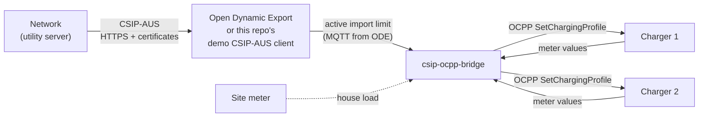

# csip-ocpp-bridge

**Open-source bridge so Australian networks can manage EV chargers over CSIP-AUS.**

The bridge takes the import limit that an electricity network sends a site over CSIP-AUS (for example "this site may import at most 3 kW from 5 to 7 pm") and caps the site's EV chargers over OCPP, the protocol chargers already speak.

<!-- TODO(week 6): replace with the demo GIF (see docs/recording-script.md) -->
> 🎬 *Demo recording coming soon: network sets 3 kW → charger drops to 3 kW → limit ends → charger recovers.*

## The problem

Australian networks control solar, batteries and flexible loads through **CSIP-AUS**, the Australian profile of IEEE 2030.5. EV chargers are managed over **OCPP**. Nothing standard sits in between.

In February 2026 an industry roundtable run by the ARENA-funded Vehicle-Grid Network (51 people from 31 organisations) named **OCPP-to-CSIP-AUS translation** as a key unresolved gap ([summary](https://zecar.com/reviews/australia-v2g-rollout-vgn-roundtable-insights)). CSIP-AUS is barely used outside Australia, so global charger makers don't prioritise it. This project fills that gap in the open.

## How it works



1. The network publishes controls (import limit, start time, duration) and a **default control** for when nothing else applies or comms are lost.
2. A CSIP-AUS client polls the network and works out the limit active right now. In production that client is [Open Dynamic Export](https://github.com/longzheng/open-dynamic-export) (ODE), which already handles TLS, certificates and network certification. This repo also has a small client of its own, used with a mock server for demos and testing.
3. The bridge subtracts the house load (from a site meter), splits what is left between the chargers, and sends each one an OCPP `SetChargingProfile` (`ChargingStationMaxProfile`, in watts).
4. Chargers report what they actually draw, and the bridge posts that back to the network as telemetry.
5. If the network link drops, the bridge falls back to the default control.

More detail: [docs/architecture.md](docs/architecture.md).

## Quick start

Needs Node 24.

```bash
npm ci
```

```bash
npm run bridge-demo
```

This starts a mock CSIP-AUS server, the bridge and two simulated OCPP 2.0.1 chargers on your machine. The site limit goes 5 kW → 3 kW for 8 s → 5 kW, and each charger follows: 2500 W → 1500 W → 2500 W. It prints `PASS` or `FAIL` and exits non-zero on failure.

Every demo and what it proves: [docs/testing.md](docs/testing.md). Installing next to ODE on real hardware: [docs/install.md](docs/install.md) (in progress for v0.1).

## What works today

All of this runs against simulated chargers and a mock CSIP-AUS server:

- CSIP-AUS client: discovers resources from `/dcap`, polls, and picks the active control on the server's clock, else the default control.
- Import limit → OCPP 2.0.1 charging profile, split equally across several chargers.
- Site meter: chargers get `limit − house load`, so a kettle or solar export changes their share.
- Fail-safe: no good poll for 3 poll intervals → apply the default control; resume the schedule when the link returns.
- Telemetry back to the network (MirrorUsagePoint / MirrorMeterReading), with failed posts kept and resent in order.

## What doesn't work yet

Being honest about the limits:

- **No certificates of our own.** Our CSIP-AUS client talks plain HTTP to a mock server. For real networks the plan is to run behind ODE, which does TLS and certificates.
- **Not tested with any real network's server.** Networks implement CSIP-AUS differently (QLD and SA differ, for example), and comms-loss rules and timeouts still need checking network by network.
- **Not tested with real chargers yet.** Only simulated OCPP 2.0.1 chargers so far. OCPP 1.6J, limits in amps and three-phase are in progress for v0.1.
- **No V2G.** One-way chargers only. Two-way charging comes later.
- **Single site.** One bridge manages one site.
- **No real site meter yet.** The site meter is simulated.

## v0.1 (in progress)

Goal: runs next to Open Dynamic Export on a Raspberry Pi-class box, takes ODE's active import limit over MQTT, caps one or more real OCPP chargers (1.6J and 2.0.1), fails safe, and installs with `docker compose up` plus one config file.

## Relationship to Open Dynamic Export

[Open Dynamic Export](https://github.com/longzheng/open-dynamic-export) is a free, open-source (MIT) CSIP-AUS gateway client by Long Zheng. It controls solar inverters, has no OCPP or EV charger support, and is certified with SA Power Networks ([opendynamicexport.com](https://opendynamicexport.com/csip-aus/)). ODE already publishes the active limit over MQTT, so this bridge is designed to sit **next to** it: ODE talks to the network, the bridge talks to the chargers. This is an independent project, not part of ODE, and we'd like to contribute EV charger support upstream where that makes sense.

## Contributing

Bug reports from real chargers and networks are the most useful thing right now. See [CONTRIBUTING.md](CONTRIBUTING.md).

## Licence

[Apache-2.0](LICENSE).
