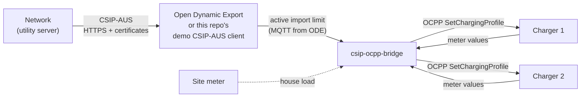

# csip-ocpp-bridge

**Open-source bridge so Australian networks can manage EV chargers over CSIP-AUS.**

The bridge takes the import limit that an electricity network sends a site over CSIP-AUS (for example "this site may import at most 3 kW from 5 to 7 pm") and caps the site's EV chargers over OCPP, the protocol chargers already speak.



*A real run of `npm run showcase`, with the quiet stretches shortened (the clock on each line shows the real times). Mock network, the real bridge program, a simulated charger. Asciinema version: [`docs/showcase.cast`](docs/showcase.cast).*

## The problem

Australian networks control solar, batteries and flexible loads through **CSIP-AUS**, the Australian profile of IEEE 2030.5. EV chargers are managed over **OCPP**. Nothing standard sits in between.

In February 2026 an industry roundtable run by the ARENA-funded Vehicle-Grid Network (51 people from 31 organisations) named **OCPP-to-CSIP-AUS translation** as a key unresolved gap ([summary](https://zecar.com/reviews/australia-v2g-rollout-vgn-roundtable-insights)). CSIP-AUS is barely used outside Australia, so global charger makers don't prioritise it. This project fills that gap in the open.

## How it works



1. The network publishes controls (import limit, start time, duration) and a **default control** for when nothing else applies or comms are lost.
2. A CSIP-AUS client polls the network and works out the limit active right now. On a real site that client is [Open Dynamic Export](https://github.com/longzheng/open-dynamic-export) (ODE), which already handles TLS, certificates and network certification, and publishes the active limit over MQTT. This repo also has a small client of its own, used with a mock server for demos and testing.
3. The bridge splits the limit between the chargers (after subtracting the house load, if it has a site meter) and sends each one an OCPP `SetChargingProfile` (`ChargingStationMaxProfile`, in watts or amps).
4. If the limit stops arriving, the bridge falls back to the network's default control.

More detail: [docs/architecture.md](docs/architecture.md).

## Quick start

Needs Node 24. No Docker, hardware or network account.

```bash
git clone https://github.com/zacharylander31/csip-ocpp-bridge.git
cd csip-ocpp-bridge
npm ci
```

```bash
npm run showcase
```

About a minute, in one terminal: a mock CSIP-AUS network, the real bridge program (`src/main.ts`, the same thing `npm start` and Docker run) and a simulated OCPP 2.0.1 charger. The network's default is 5 kW, then it sets 3 kW for 30 s; the charger follows 5000 → 3000 → 5000 W. It checks the result and exits non-zero if the charger didn't follow.

Every other demo and what it proves: [docs/testing.md](docs/testing.md). Running it next to ODE on a site: [docs/install.md](docs/install.md). Every config option: [docs/configuration.md](docs/configuration.md).

## What works today

Proven by automated checks that run in CI on every push, all against **simulated** chargers and a **mock** CSIP-AUS server:

- **With the real Open Dynamic Export.** `docker compose up` runs the bridge, mosquitto and the real ODE `v0.20.0` image; ODE talks HTTPS with certificates to the mock network, and with a 500 W house load the charger follows 4500 → 2500 → 4500 W (a 5 kW default and a 3 kW control, minus the house).
- **Site meter:** the bridge reads the meter already set up in ODE, so chargers get `limit − house load`, and more when solar is exporting. If the meter goes silent for 15 s, chargers get 0 W until it's back.
- **OCPP 1.6J and 2.0.1** chargers on the same bridge; caps in watts or amps; single or three phase; below ~6 A per phase the charger is paused instead of given a current the car can't use. Amps are worked out at 253 V, so a high supply voltage can't push the real draw over the share.
- **Several chargers** share what's left of the site limit equally.
- **Fail-safe:** no fresh limit for a set time (ODE silent, broker down, network unreachable) → the network's default control.
- **Chargers that reboot or reconnect** get their cap re-sent.
- **Only configured chargers** may connect: unknown ids are refused at the handshake (HTTP 404). **Per-charger passwords** (OCPP Security Profile 1, HTTP Basic auth) are optional per charger; a missing or wrong one is refused (HTTP 401). Passwords come from environment variables, never the config file, and never appear in logs.
- **Runs as a service:** one JSON config file, checked strictly at start-up; text or JSON logs; clean shutdown that leaves the caps in place.
- The bridge's own CSIP-AUS client (for the mock server) also posts telemetry back (MirrorUsagePoint / MirrorMeterReading).

## What doesn't work yet

Being honest about the limits:

- **Not tested with a real network's server.** Only with our mock. Networks implement CSIP-AUS differently (QLD and SA differ), and comms-loss rules and timeouts still need checking network by network.
- **Not tested with a real charger.** Every charger so far is our simulator. Real firmware will have quirks.
- **No TLS between charger and bridge** (OCPP Security Profile 2). Passwords cross the local network in plain text, and a charger without a password can be impersonated by a device that knows its id.
- **No V2G.** One-way chargers only.
- **ODE ramps import limits slowly.** ODE ramps every limit change at the network's `setGradW` × the *solar inverter's* nameplate. With SA Power Networks' setting and a 5 kW inverter, 5 kW → 3 kW takes about 2.5 minutes, so a short control barely moves the charger. We think that ramp shouldn't apply to an EV import limit and plan to raise it with ODE.
- **ODE doesn't fail safe on its own** when it loses the network: it keeps following its cached schedule. The bridge's fail-safe only covers ODE going silent.
- **The site meter is untested on real hardware.** It works through ODE with simulated meters and chargers. It needs each charger to report power every few seconds: the bridge asks, but a charger that refuses gets throttled, because its draw looks like house load ([install guide](docs/install.md#site-meter)). There's no site meter without ODE (reading SunSpec/Modbus directly).
- **arm64 (Raspberry Pi) image** not built or tested yet; CI only covers amd64.
- **Single site.** One bridge manages one site. A paused charger's share isn't given to the others.

## Relationship to Open Dynamic Export

[Open Dynamic Export](https://github.com/longzheng/open-dynamic-export) is a free, open-source (MIT) CSIP-AUS gateway client by Long Zheng. It controls solar inverters, has no OCPP or EV charger support, and is certified with SA Power Networks ([opendynamicexport.com](https://opendynamicexport.com/csip-aus/)). This bridge is designed to sit **next to** it: ODE talks to the network, the bridge talks to the chargers. This is an independent project, not part of ODE, and we'd like to contribute EV charger support upstream where that makes sense.

## Contributing and security

Reports from real chargers and networks are the most useful thing right now. See [CONTRIBUTING.md](CONTRIBUTING.md). Found a security problem? Please report it privately: [SECURITY.md](SECURITY.md).

## Licence

[Apache-2.0](LICENSE).
