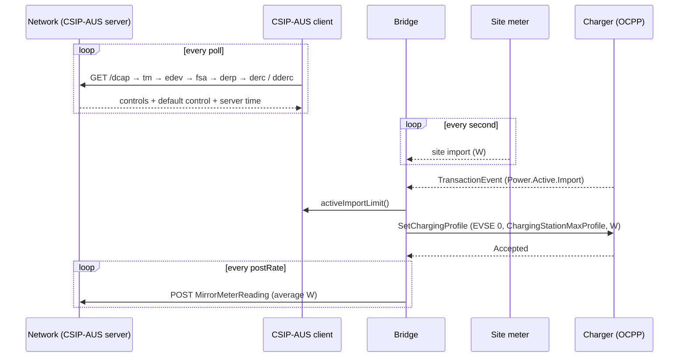

# Architecture

How "limit this site to 3 kW import" becomes chargers drawing at most 3 kW between them.

## The network side: CSIP-AUS

CSIP-AUS is the Australian profile of IEEE 2030.5 ([BSGIP v1.2 explainer](https://bsgip.com/wp-content/uploads/2025/05/CSIP-AUS-v1.2-explainer-May-2025-release.pdf)). Networks and retailers send controls to DER (solar, batteries, EV chargers) and get data back.

- **Controls** include export limit, import limit (for flexible loads like EV chargers), generation limit, load limit, de-energise and disconnect. Each has a start time and duration.
- **Default controls** apply when no control is active or comms fail.
- The client **polls** the server over HTTPS.
- **Client types:** direct, aggregator, gateway, inverter built-in. This bridge is the **gateway** kind: a device on site.
- **Security** is PKI: device certificate ← manufacturer certificate ← utility root.
- One-way EV chargers are subject to import limits; two-way chargers to import and export limits.

In production the CSIP-AUS side is handled by [Open Dynamic Export](https://github.com/longzheng/open-dynamic-export), which already parses all CSIP-AUS limits including `opModImpLimW` and `opModLoadLimW`, schedules them, handles default/fallback controls, and publishes the active limit over MQTT. This repo's own client (`src/csipClient.ts`) exists to learn the protocol and drive the demos against a mock server.

## The charger side: OCPP 2.0.1

- Library: [`ocpp-rpc`](https://www.npmjs.com/package/ocpp-rpc) with `strictMode` on, so every message is checked against the OCPP JSON schemas.
- **Capping:** `SetChargingProfile` to **EVSE 0** (whole station), purpose `ChargingStationMaxProfile`, kind `Absolute`, one schedule period with a `limit` in W.
- **Removing the cap:** `ClearChargingProfile` with the profile's id.
- **Reading power:** during a transaction the charger reports `Power.Active.Import` in `TransactionEvent` (`eventType: Updated`, `triggerReason: MeterValuePeriodic`).

## The bridge

`src/bridge.ts` runs three loops:

1. **Poll** the CSIP-AUS server every `pollMs`. A poll that fails halfway changes nothing.
2. **Tick** every `tickMs`: take the active import limit, subtract the house load, split the rest equally across chargers, and send a new cap only to chargers whose share changed. Sends happen in parallel; a charger that fails or rejects is retried next tick without blocking the others.
3. **Telemetry** every `postRate`: post the chargers' average power (and the site's) back to the network.

### Splitting the site limit

- House load = site meter reading − chargers' latest readings, using only readings that arrived **after** the last cap change was acknowledged. House load can be negative when solar is exporting.
- Each charger gets `(limit − house) / chargers`, rounded down to 100 W.
- Lower shares are sent at once. Higher shares are only sent when they rise by at least 300 W, to avoid chatter.
- No recent house estimate (no reading, or older than 60 s) → chargers get 0 W.
- A charger with no reading for 5 s counts as 0 W, which overstates the house load: the safe side.

### Fail-safe

If there's no good poll for `commsLostAfterMs` (default: 3 poll intervals), the bridge applies the default control from the last good poll, even in the middle of a control. The schedule resumes on the next good poll. Each network's actual comms-loss rule and timeout still needs checking.

### Telemetry

One MirrorUsagePoint for the chargers (roleFlags `45`: mirror + PEV + submeter) and one for the site (`03`). Each reading is the average real power over a `postRate` interval, lined up to the server's clock. Failed posts are kept (up to 12) and resent in order after re-registering. XML element order and codes follow Open Dynamic Export.

## Timing gotchas

- **A meter reading can already be in flight when a command is sent.** Only readings received after the charger's reply are guaranteed to reflect a new limit. The bridge and the demos both follow this rule.
- **`/tm` has 1-second resolution**, so the client's estimate of server time can be up to 1 s off, and it moves a little on every poll. Nothing should depend on a control boundary with sub-second precision.

## Source files

| File | What it does |
|---|---|
| `src/csipClient.ts` | CSIP-AUS client: discover, poll, pick the active limit, register mirrors, post readings |
| `src/mockCsipServer.ts` | Mock CSIP-AUS server (HTTP, no TLS) with XML modelled on real SAPN/EQL responses |
| `src/mirrorXml.ts` | MirrorUsagePoint / MirrorMeterReading XML |
| `src/bridge.ts` | The bridge: poll, tick and telemetry loops |
| `src/csms.ts` | Minimal OCPP 2.0.1 central system: accepts chargers, records readings, caps and uncaps |
| `src/chargerSim.ts` | Simulated OCPP 2.0.1 charger (EV wants 7.4 kW, obeys the lowest limit) |
| `src/siteMeterSim.ts` | Simulated site meter |
| `src/telemetry.ts` | Average power over an interval |
| `src/run*.ts`, `src/checkCsipClient.ts` | Demos and checks, see [testing.md](testing.md) |

## Known simplifications

- OCPP Security Profile 1 only (optional per-charger passwords, plain text without TLS); no TLS (Security Profile 2/3).
- No stack levels or time-limited schedules in charging profiles.
- Single-phase amps-to-watts conversion (230 V).
- Equal split between chargers: an idle charger keeps its share.
